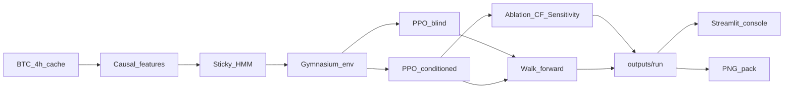

# Regime Audit Console

> **For agentic workers:** REQUIRED SUB-SKILL: Use superpowers:subagent-driven-development (recommended) or superpowers:executing-plans to implement this plan task-by-task.

**Goal:** A single-asset research prototype whose regime-to-action link is tested (ablation, counterfactual, sensitivity), plus a local console that makes those tests visible.

**Architecture:** Cached Binance OHLCV → causal features → 4-state sticky Gaussian HMM with labels locked by sorting states on mean return and volatility → one Gymnasium env and one PPO trainer (`include_regime` flag) → verification on the frozen policy → walk-forward metrics. The console only reads saved artifacts and runs inference. It never trains and never sends orders.

**Tech stack:** Python 3.11, `uv`, pandas/numpy, `ccxt`, `hmmlearn`, Gymnasium, Stable-Baselines3 PPO (CPU), scipy bootstrap, Streamlit + Plotly. Repo: [Regime-Control](/Users/varaddurge/Documents/Regime-Control).

**Skipped from the existing [Regime_Build_Plan.md](/Users/varaddurge/Downloads/Regime_Build_Plan.md):** FinRL submodule, Kaggle order book, Wasserstein/`POT`, wandb, captum, quantstats, a GPU requirement. Add those only if a measured gap shows up (label flips after moment-sorting, or a professor requires FinRL). The spec’s “use an existing RL library” requirement is Stable-Baselines3, not a second framework wrapped around it.

---

## Final product

Not a bot, not a broker, not a website you leave running. Three artifacts:

1. **The experiment** — `uv run python -m crta.pipeline` fetches BTC/USDT 4h from 2021-01-01, fits the HMM, trains the blind and conditioned agents under the same hyperparameters, writes walk-forward Sharpe/Sortino with bootstrap intervals, and writes a per-bar faithfulness pass rate.
2. **The console** — `uv run streamlit run src/crta/demo.py`. One screen. Scrub a date, read the regime, read the position, flip a counterfactual regime, drag regime confidence 0→1 and watch the position move.
3. **The picture pack** — PNGs in `outputs/figures/` that match the console, so an X post does not depend on the app being open.

A passing project can lose to buy-and-hold. The headline is the faithfulness rate and the regime-segmented gap versus the blind twin, including when the check fails. The UI labels every run `probe policy` or `trained PPO` so a mentor never sees a scripted rule dressed up as a learned agent.

## What you show

**Mentors (about 5 minutes, laptop, no deploy):** open the console on the 2022 crash. Regime ribbon goes to crisis, conditioned position cuts risk, blind twin does not, buy-and-hold draws down. Pick one bar, run the three checks, read pass/fail in one sentence each. End on the pass-rate and the bootstrap intervals. Say it is a historical backtest.

**X:** post the PNGs plus one screen recording of the sensitivity slider and the “force calm during the crash” control. Caption states backtest, single asset, not a signal. The console footer is the same sentence: `Historical research. Not a trading signal.` No public URL in this build. Screen-share covers a viva. Add hosting only if a mentor cannot watch the laptop.

## Console (one page, not a terminal clone)

Light editorial plate, like a lab tear-sheet: paper `#f4f0e6`, ink `#1c1915`, Fraunces headlines, IBM Plex Mono numbers. Regime inks: bull `#b5813a`, bear `#3d5a80`, calm `#6b7f6a`, crisis `#9c3b2e`. No purple gradient, no Binance clone.

- Top line: symbol, window, faithfulness percent, model badge (`probe` or `trained`).
- Main: price with regime bands underneath, three equity curves (conditioned, blind, buy-and-hold).
- Audit card for the selected bar: regime probabilities, position, ablation delta, counterfactual direction, sensitivity sparkline, three pass/fail lines.
- Controls: date, “force regime”, confidence slider. Slider calls the frozen policy. It does not refit anything.

Until training artifacts exist, the console loads a **probe policy** (crisis/bear → flat or short, calm/bull → long) so the checks have a known answer and the UI is screenshot-ready. The badge stays `probe policy`.

## Contracts (so the tests have teeth)

- **No lookahead.** Every feature at time t uses rows `<= t` only. Rolling windows are trailing.
- **HMM.** 4 Gaussian states on log-return, 20-bar realized vol, close/SMA−1. Fit on the training prefix only; decode the test segment with that model. Minimum dwell = 6 bars (24h), applied by merging shorter runs into the previous label. After each fit, lock names by sorting on mean return, then vol: low-return+high-vol = crisis, low-return+low-vol = bear, high-return+low-vol = calm, high-return+high-vol = bull.
- **Agents.** Action in `[-1, 1]`. Reward = position × next log-return − `0.001 * |Δposition|`. Same PPO hyperparameters, seed `42`, timestep budget. Observation differs only by a 4-d regime probability vector. That input-layer difference is the experiment, and the README says so.
- **Ablation pass.** `|a − a_zeroed| >= 0.15`.
- **Counterfactual pass.** Forcing a more defensive regime (crisis ≻ bear ≻ calm ≻ bull) moves the position down by at least `0.10`. The opposite force must move it up.
- **Sensitivity pass.** 11-point sweep of P(crisis) from 0 to 1, other probabilities renormalized. Position is non-increasing with at most one violation.
- **Verdict.** A bar passes only if all three pass. Headline = pass rate on the test folds.
- **Eval.** 4 expanding walk-forward folds. No static split. Sharpe and Sortino on per-bar returns, 1000-resample bootstrap intervals. Breakdown by regime plus the aggregate. Third system is buy-and-hold (position = 1).

## Files

- [pyproject.toml](pyproject.toml) — `uv`, Python 3.11
- [src/crta/data.py](src/crta/data.py) — ccxt fetch, parquet cache, causal features
- [src/crta/regime.py](src/crta/regime.py) — sticky HMM + moment label lock
- [src/crta/agent.py](src/crta/agent.py) — env, probe policy, PPO train (`include_regime`)
- [src/crta/verify.py](src/crta/verify.py) — three tests + verdict
- [src/crta/eval.py](src/crta/eval.py) — folds, metrics, writes `outputs/`
- [src/crta/plots.py](src/crta/plots.py) — shared Plotly/PNG theme
- [src/crta/demo.py](src/crta/demo.py) — Streamlit console
- [src/crta/pipeline.py](src/crta/pipeline.py) — one entry: data → train → verify → figures
- tests: `test_data.py`, `test_regime.py`, `test_verify.py`, `test_eval.py`
- Copy [SPEC.md](/Users/varaddurge/Downloads/SPEC.md) and [reading_list.md](/Users/varaddurge/Downloads/reading_list.md) into the repo root
- [README.md](README.md) — setup, 5-minute mentor script, X shot list, the disclaimer

`tests/test_verify.py` is the non-negotiable check: probe policy passes; a policy that ignores regime fails ablation; a policy that buys harder in a crisis fails the counterfactual.

## Build order

Each step leaves something runnable. Do not start PPO until the console and the synthetic checks are green.

1. Scaffold `uv` project and package. `uv run pytest` collects.
2. Data + leakage test (truncated frame equals prefix of the full frame).
3. HMM on a synthetic calm-then-crisis series. Dwell holds. The crash half is not labeled calm.
4. Verification against the probe and the two failing policies.
5. Console on the probe + cached or synthetic series. Export the four PNGs (ribbon, equity, sensitivity, one audit card).
6. PPO blind and conditioned. Swap artifacts into the console. Badge flips to `trained PPO`.
7. Walk-forward report. README mentor script and shot list.

## Out of this build

Paper draft, college PDF formatting, live capital, order-book data, Wasserstein identity tracking, hosted demo. The synopsis objectives 1–5 are all inside steps 2–7.