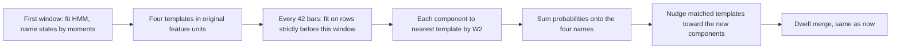

# Wasserstein regime identity

The regime layer today fits one 4-state Gaussian HMM per walk-forward fold and names the states by sorting means on return, then volatility ([src/crta/regime.py](src/crta/regime.py) `lock_states`). A new fit can hand those four Gaussians back in any order. Sorting repairs the names, but it is not the identity method in Boukardagha, *Explainable Regime-Aware Investing* (arXiv:2603.04441, §5.4).

That paper keeps a fixed set of Gaussian templates. On each refit it maps every new component to the nearest template by the closed-form 2-Wasserstein distance, sums the probabilities of components that land on the same template, and moves the template a small step toward the components just assigned to it. This plan builds that tracker and nothing else from the paper.

## What stays fixed

The rest of the desk assumes exactly four names. The agent observation, the three checks, and the console all read `bull`, `bear`, `calm`, `crisis`. So:

- Template count stays 4. The paper’s weekly search over the number of states is out of this pass; a changing count would break that contract.
- The mean-variance portfolio layer in the paper is not ported. PPO twins stay the decision maker.
- No new dependency. Emissions are diagonal, and for two diagonal Gaussians the paper’s trace formula reduces to `sum((mu1-mu2)^2 + (sd1-sd2)^2)`. `POT` is unnecessary.
- Dwell smoothing stays. It still merges runs shorter than 30 bars. Identity tracking answers a different question: which state is which after a refit.

## How a bar gets its label

- Burn-in is long enough to fit (a few hundred bars). That first fit is the only place `lock_states` runs, so “crisis” still starts as low-return, high-vol. Later windows never re-sort.
- Refit stride is 42 bars, about a week of 4h data. The model for a window is fit only on rows before that window, then applied forward. Templates live in original feature units, undoing each window’s own scaler, so a later window can be compared with an earlier one.
- Matching is independent nearest-template, as in the paper, not a one-to-one assignment. Two components may share a template; that template’s probability is their sum, and an unmatched template keeps probability 0 and is not moved.
- Smoothing uses a small fixed rate (0.2): `template = 0.8 * template + 0.2 * assigned components`.
- One causal pass over the whole series replaces the per-fold `fit_regime` / `decode` pair in [src/crta/pipeline.py](src/crta/pipeline.py). Walk-forward slices that label series. Column names in the saved bars do not change, so the console needs no layout change.

## Tests

In [tests/test_regime.py](tests/test_regime.py):

- Identical diagonal Gaussians have distance 0. A pure mean shift matches the closed form.
- Take a fitted model, swap two component indices, and check the tracker assigns the same template names. This is the failure moment-sorting is not specifically tested for.
- On a two-step synthetic path, append bars after a window and check that window’s labels do not change.
- The existing dwell test and the “crash half is not calm” test still pass.

## What this task does not do

- No PPO retrain. Saved actions stay as they are until you ask for a full `pipeline` run. The tests prove the tracker; a retrain is hours and is a separate step.
- No multi-asset run, no SHAP comparison, no testnet loop, no console redesign.

